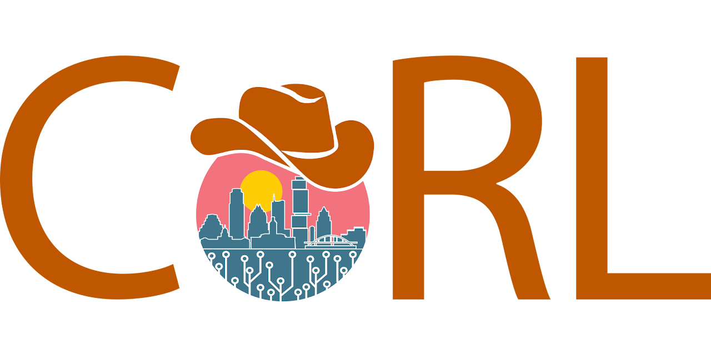
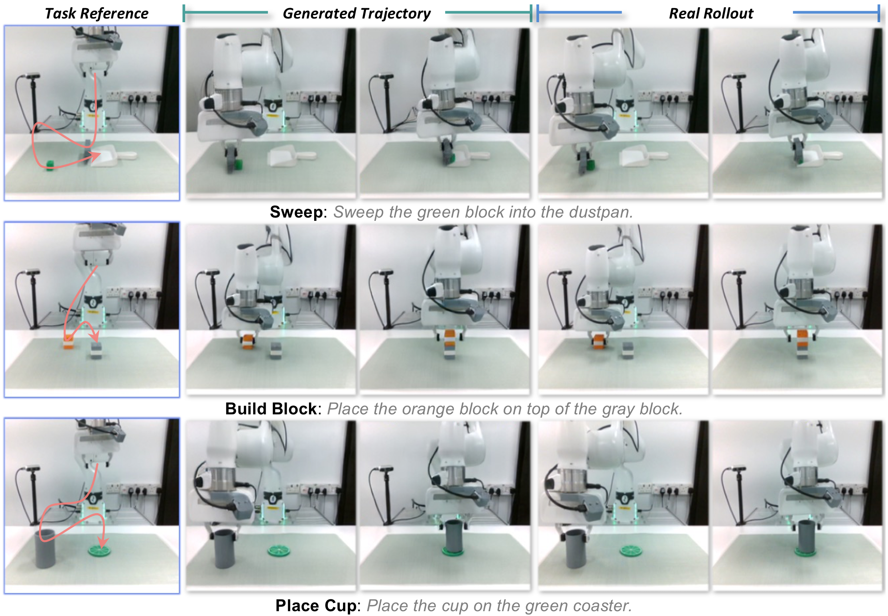

<div align="center">



# MetaWAM

### From Video Frames to Robot Meta-Frames: A Unified Latent Interface for World Action Models

**Accepted at CoRL 2026 🎉**

[](https://www.corl.org/)
[](https://arxiv.org/abs/2611.14365)
[](https://huggingface.co/Ethanliang99/MetaWAM-RoboCasa-Predict2-2B)
[](https://huggingface.co/Ethanliang99/MetaWAM-LIBERO-Predict2-2B)
[](https://huggingface.co/Ethanliang99/MetaWAM-RealWorld-Predict2-2B)

[](LICENSE)
[](SETUP.md)
[](https://pytorch.org/)
[](https://github.com/NVlabs/cosmos-policy)

</div>

MetaWAM packs heterogeneous robot signals into a single distribution-aware meta-frame, providing a unified latent interface for policy, world-model, and value prediction.

MetaWAM fine-tunes a pretrained video diffusion model (Cosmos-Predict2-2B-Video2World) into a World Action Model that jointly predicts actions, future observations, future proprioception and values. It does not spend a separate latent frame on each robot signal. Instead, all signals go into compact **meta-frames**:

* **Distribution-aware spectral lifting.** Each robot signal is written into fixed coefficient slots of a disjoint channel band and lifted to the spatial latent by an orthonormal 2D inverse DCT. Readout is a 2D DCT followed by fixed slot unpacking, with no learned encoder or decoder.
* **Conditioning-only input meta-frame.** The tokenizer's mandatory blank slot carries the task type and the current proprioception.
* **Slot-aware task routing.** Band-level masks decide which signals in the output meta-frame are clean conditions and which are denoising targets. One model can therefore train policy, world-model and value prediction together.

On RoboCasa, this shortens the latent sequence from 11 to 8 frames and cuts inference latency by 39% compared with frame-injection Cosmos Policy. The denoiser architecture is unchanged.

## 📰 News

- **[2026.11]** 📄 Paper released on [arXiv](https://arxiv.org/abs/2611.14365); code and model checkpoints released.
- **[2026.09]** 🎉 MetaWAM is accepted to CoRL 2026.

## Real-World Rollouts



## RoboCasa Results

MetaWAM is evaluated on 24 RoboCasa tasks using 50 demonstrations per task.

| Method | Demos / Task | Avg. Success Rate (%) |
|:--|--:|--:|
| UVA | 50 | 50.0 |
| DP-VLA | 3,000 | 57.3 |
| UWM | 1,000 | 60.8 |
| π₀ | 300 | 62.5 |
| GR00T-N1.5 | 300 | 64.1 |
| Video Policy | 300 | 66.0 |
| FLARE | 300 | 66.4 |
| Cosmos Policy | 50 | 67.1 |
| **MetaWAM (ours)** | **50** | **68.9** |

## LIBERO and LIBERO-Plus Results

The `Original` column is the standard LIBERO benchmark. All values are average success rates (%). Results for the published baselines are reproduced from [Table 4 of *Do World Action Models Generalize Better than VLAs? A Robustness Study*](https://arxiv.org/abs/2603.22078).

| Model | Original | Total |
|:--|--:|--:|
| π₀ | 94.2 | 53.6 |
| π₀ (rerun) | 91.3 | 69.4 |
| π₀-FAST | 85.5 | 61.6 |
| π₀.₅ | 96.9 | 85.7 |
| OpenVLA-OFT_m | 97.6 | 67.9 |
| UniVLA | 95.2 | 42.9 |
| RIPT-VLA | 97.5 | 68.4 |
| X-VLA | 98.1 | 71.4 |
| HoloBrain0-GD | 96.7 | 74.0 |
| ABot-M0 | 98.6 | 80.5 |
| VLA-JEPA | 97.2 | 77.9 |
| GE-Act | 94.4 | 80.3 |
| Cosmos Policy | 98.5 | 82.2 |
| Fast-WAM | 97.6 | 51.5 |
| MetaWAM (ours) | 98.1 | 83.4 |

## Checkpoints

| Model | Inference config | Files |
|---|---|---|
| [MetaWAM-RoboCasa-Predict2-2B](https://huggingface.co/Ethanliang99/MetaWAM-RoboCasa-Predict2-2B) | `metawam_robocasa__inference` | `MetaWAM-RoboCasa-Predict2-2B.pt`, `robocasa_dataset_statistics.json`, `robocasa_t5_embeddings.pkl` |
| [MetaWAM-LIBERO-Predict2-2B](https://huggingface.co/Ethanliang99/MetaWAM-LIBERO-Predict2-2B) | `metawam_libero__inference` | `MetaWAM-LIBERO-Predict2-2B.pt`, `libero_dataset_statistics.json`, `libero_t5_embeddings.pkl` |
| [MetaWAM-RealWorld-Predict2-2B](https://huggingface.co/Ethanliang99/MetaWAM-RealWorld-Predict2-2B) | `metawam_realworld__inference` | `MetaWAM-RealWorld-Predict2-2B.pt`, `realworld_dataset_statistics.json`, `realworld_t5_embeddings.pkl` |

```bash
hf download Ethanliang99/MetaWAM-RoboCasa-Predict2-2B --local-dir checkpoints/MetaWAM-RoboCasa-Predict2-2B
hf download Ethanliang99/MetaWAM-LIBERO-Predict2-2B --local-dir checkpoints/MetaWAM-LIBERO-Predict2-2B
hf download Ethanliang99/MetaWAM-RealWorld-Predict2-2B --local-dir checkpoints/MetaWAM-RealWorld-Predict2-2B
```

For RoboCasa and LIBERO, the dataset statistics and T5 embedding files are identical to the ones released with Cosmos Policy. The real-world checkpoint is a single policy trained jointly on the three Franka tasks; it is tied to our robot setup (see [REALWORLD.md](REALWORLD.md)).

## Getting Started

1. Set up the environment: [SETUP.md](SETUP.md). It is the same environment as Cosmos Policy.
2. Simulation benchmarks:
   * [ROBOCASA.md](ROBOCASA.md): evaluation and training on RoboCasa.
   * [LIBERO.md](LIBERO.md): evaluation (including LIBERO-Plus) and training on LIBERO.
3. Real robot: [REALWORLD.md](REALWORLD.md) covers data collection, training and deployment on a Franka Panda.

Launch scripts are in [`scripts/`](scripts/). Experiment configs are in
[`cosmos_policy/config/experiment/cosmos_policy_experiment_configs.py`](cosmos_policy/config/experiment/cosmos_policy_experiment_configs.py).

## Code Map

MetaWAM is implemented on top of the Cosmos Policy codebase:

| Component | Location |
|---|---|
| Meta-frame packing / 2D DCT lifting and readout, slot-aware masks, spectral losses | `cosmos_policy/models/policy_text2world_model.py` |
| Input meta-frame, dual-granularity (slot + coarse) conditioning masks | `cosmos_policy/models/policy_video2world_model.py` |
| Slot-mask embedder in the DiT | `cosmos_policy/_src/predict2/networks/minimal_v1_lvg_dit.py` |
| Meta-frame readout at inference (actions, future proprio, value) | `cosmos_policy/experiments/robot/cosmos_utils.py` |
| Datasets | `cosmos_policy/datasets/{robocasa,libero,realworld_lerobot}_dataset.py` |

Setting `use_single_meta_frame=False` falls back to the original Cosmos Policy frame-injection layout.

## 📌 Roadmap & Status

- [x] Release the paper/preprint
- [x] Release the inference and evaluation code
- [x] Release the model checkpoints
- [x] Release the training code

## Citation

```bibtex
@inproceedings{liang2026metawam,
  title     = {From Video Frames to Robot Meta-Frames: A Unified Latent Interface for World Action Models},
  author    = {Liang, Guoqiang and Lin, Yiqi and Chen, Yanzhe and Ma, Kevin Yuchen and Shou, Mike Zheng},
  booktitle = {Conference on Robot Learning (CoRL)},
  year      = {2026}
}
```

## Acknowledgements

This repository is built on [Cosmos Policy](https://github.com/NVlabs/cosmos-policy) and [Cosmos-Predict2](https://github.com/nvidia-cosmos/cosmos-predict2). See [ATTRIBUTIONS.md](ATTRIBUTIONS.md) and [LICENSE](LICENSE).
